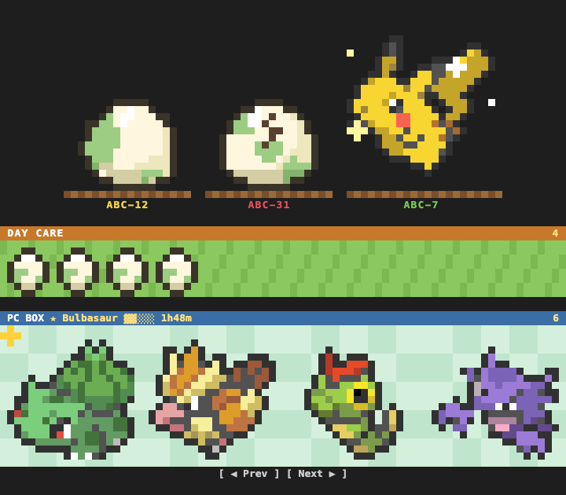

# mod-hud

English | [한국어](README.ko.md)

A Claude Code mod that shows, at a glance, which of your many open Claude Code sessions is waiting on you.
A one-line band always sits above the prompt, and `/mod-hud` opens the full panel.
While you work, every session also raises a Pokémon egg that hatches when its MR is merged.

It runs inside the Claude Code engine, so there is no Node, npm or React to install, and it works regardless of your project's language (Python and so on).

## What it shows

| Section | Contents | Requires |
| --- | --- | --- |
| Your turn | Sessions that finished answering or stopped to ask a question. Sends an OS notification if one sits untouched for over a minute | Nothing |
| Working | Working sessions, todo progress, failing checks (pytest, ruff, mypy, pnpm test, etc.) | Nothing |
| Worktree | For each worktree of the current repo: branch, commits ahead of the base branch, number of changes, MR status | A git repo. MR status needs GitLab and a token |
| MR | MRs that have conflicts or are ready to merge | GitLab and a token |
| Linear Inbox | Unread Linear notifications where you were mentioned or someone replied to your comment. Status changes made by GitLab are left out | The Linear connector on claude.ai |
| Pokémon eggs | A nest per open session, the DAY CARE and the PC BOX at the bottom of the panel. See [Pokémon eggs](#pokémon-eggs) | A panel docked beside the transcript. `curl` and network access for sprites |

Sections whose requirements aren't met are simply hidden.

## Pokémon eggs



At the bottom of the docked panel there is one nest per open session.

- **DAY CARE (키우미집)**: refilled with 7 eggs every day at local midnight (leftovers don't carry over). The remaining count is always shown, `0` when empty. A session that starts working takes one egg. When it is empty the session stays an empty nest, and when an egg comes back a working empty session takes it.
- **Egg**: a round green-spotted egg, with one of six spot patterns. It rocks like a roly-poly toy while the session works (yellow label), cracks when the MR of its branch opens, and hatches into a bouncing Pokémon when that MR is merged. A red label means the session is waiting on you. An MR that was already merged before the egg was taken doesn't hatch it. Only the 74 unevolved, non-legendary Gen 1 Pokémon come out of eggs; which one depends on the egg.
- **When the session closes**: a hatched Pokémon goes to the PC BOX (or press its "Send to PC BOX" button to send it right away). An egg whose MR is still open stays cracked and waits for the merge. The egg of a session closed without an MR goes back to the DAY CARE.
- **PC BOX**: one row of 18-dot icons per page. Page through it with the ◀ Prev / Next ▶ buttons under it. Hover over an icon to see the Pokémon at full size with its name, the day it was caught and what it evolves into.
- **Evolution**: one Pokémon in the PC BOX leads (★) and gains experience while your sessions work. Every 3 hours of session work (three sessions working for an hour count as 3 hours) it evolves one stage, and the bar starts over. The header shows the leader, its bar and the time left, for example `★ Bulbasaur ▓▓░░░ 1h48m`. Pick the leader with **Set as lead** on its hover card. Without a pick, a species you have 3 or more of goes first, then the Pokémon caught earliest. A leader stays until it reaches its final form. Gaps over 5 minutes (sleep, all sessions closed) don't count. Evolution stays within Gen 1, and Eevee evolves into one of its three forms.
- **Legendary Pokémon** never hatch from eggs. They come to the PC BOX once each:

  | Legendary | When |
  | --- | --- |
  | Articuno | You evolve an Ice-type final form for the first time (Dewgong, Cloyster) |
  | Zapdos | You evolve an Electric-type final form for the first time (Raichu, Magneton, Electrode, Jolteon) |
  | Moltres | You evolve a Fire-type final form for the first time (Charizard, Ninetales, Arcanine, Rapidash, Flareon) |
  | Mewtwo | 100 species have been in your PC BOX |
  | Mew | All 150 other species have been in your PC BOX |

- A session you use as a dashboard can be left out with `/mod-hud dashboard` (run it again to undo).

Everything is kept in `~/.claude/mod-hud-pokedex.json`, shared across sessions and repos. Sprites (Gen VII box icons) and English names come from [PokeAPI](https://pokeapi.co) the first time they're needed and are cached in `~/.claude/mod-hud-sprites/`; until then a Poké Ball stands in.

## Install

Add the marketplace and install from a Claude Code terminal.

```bash
claude plugin marketplace add reeny404/mod-hud
claude plugin install mod-hud@hyoyyoi
```

Choose the `user` scope when installing, so it's enabled in sessions for every project.
After installing, open a new session (or run `/reload-plugins` in an open one), then type `/mod-hud` to check that the panel appears.

To update:

```bash
claude plugin marketplace update hyoyyoi
claude plugin update mod-hud
```

## Showing GitLab MRs

If the `origin` remote is GitLab, mod-hud looks up MRs. It looks for a token in this order:

1. The `GITLAB_TOKEN` environment variable
2. `GITLAB_TOKEN=...` in `.env.local` at the repo root

To pass it as an environment variable, put it under `env` in `~/.claude/settings.json` so it only applies to Claude Code sessions.

```json
{ "env": { "GITLAB_TOKEN": "<token with read_api scope>" } }
```

Create the token in GitLab > Preferences > Access Tokens with the `read_api` scope.

## Options

Change these in the plugin settings under `/config`, or on the install screen.

| Option | Default | Description |
| --- | --- | --- |
| `gitlabUrl` | empty | GitLab API URL. When empty it's derived from the remote URL. Only set it when you use an ssh remote and the web port differs |
| `baseBranch` | empty | Branch to count commits against. When empty, `origin/HEAD`, falling back to `main` |
| `autoCleanup` | `false` | Automatically removes worktrees and local branches whose MR is merged and that have no remaining changes |

### Turning on autoCleanup

It's off by default because it deletes worktrees and branches. Turn it on in one of three ways:

- While installing: `claude plugin install mod-hud@hyoyyoi --config autoCleanup=true`
- After installing: open `/config` in Claude Code and turn on mod-hud's `Auto cleanup merged worktrees`
- If you load the folder directly with `--plugin-dir` or `CLAUDE_CODE_PLUGIN_DIRS`: add it to `~/.claude/settings.json`

  ```json
  { "pluginConfigs": { "mod-hud": { "options": { "autoCleanup": true } } } }
  ```

When on, each worktree check (every 2 minutes) removes only worktrees that meet all of these:

- It isn't the main worktree
- The branch's MR is merged (so this needs a GitLab token)
- It has no uncommitted changes
- The local HEAD matches the MR's last commit. If there are commits not in the MR, it's kept
- No session is open in that worktree. A session that has only been waiting for input for over a day doesn't count as open

It removes the worktree with `git worktree remove`, then deletes the local branch with `git branch -D`. `-D` is used so squash-merged branches are removed too, and the HEAD check above ensures no commits missing from the MR are lost.
Each removal shows a toast and leaves a line under the Worktree section. If any condition fails, it keeps the worktree and shows the reason as `merged, cleanup on hold: ...`.

## Known limitations

- Raising a session with an open permission prompt to "permission needed" doesn't work yet, because Claude Code doesn't pass that notification event to mods.
- Session state is kept as one file per session in `~/.claude/mod-sessions/`, and files older than a day are deleted.
- Issue keys are read from branch names, so they need an uppercase key, as in `feat/#ABC-12-x` or `fix/ABC-12-x`.

## Development

```bash
claude plugin validate .
claude plugin test .
```
